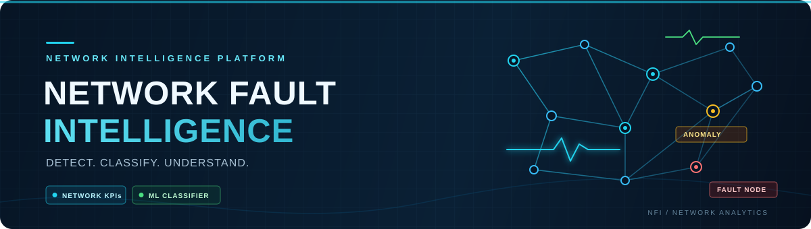
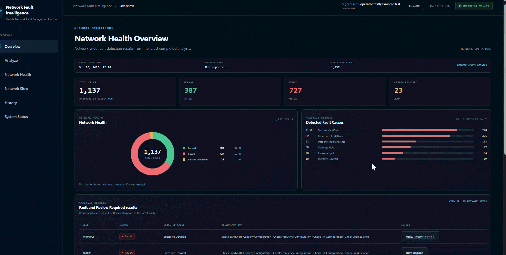
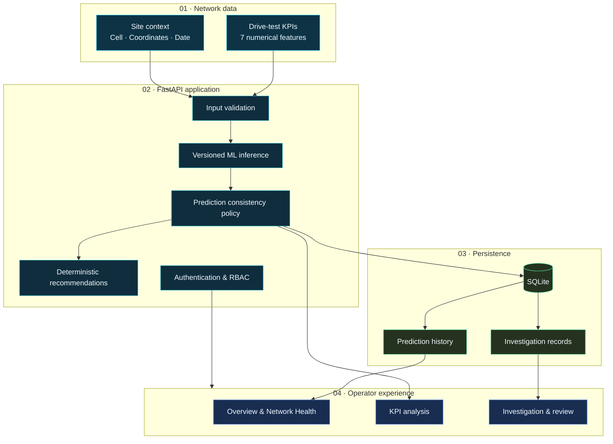

 
<p align="center">
  
</p>

<p align="center">
  
  
  
</p>

<p align="center">
  
  
  
  
  
  
</p>

<p align="center">
  <strong>From mobile-network KPIs to structured fault investigations.</strong>
  <br />
  A research-driven platform combining deep-learning-based fault detection, fault-cause classification, deterministic troubleshooting, and historical investigation workflows.
</p>

<p align="center">
  <a href="https://github.com/ghozlanetata/network-fault-intelligence-platform">Explore the Repository</a>
  &nbsp; · &nbsp;
  <a href="#-api-reference">API Documentation</a>
  &nbsp; · &nbsp;
  <a href="#-modernized-ml-pipeline">ML Pipeline</a>
</p>


---

## 🛰️ The project

Network Fault Intelligence (NFI) is a software engineering and machine-learning platform developed from the foundation of my Master's thesis and internship project on **deep-learning-based fault recognition and self-healing in wireless networks**.

The original research focused on analyzing drive-test and mobile-network performance indicators across 2G, 3G, and 4G environments. The modernized implementation brings that research into a structured application with validated API contracts, separate fault-detection and fault-classification models, deterministic troubleshooting rules, persistent prediction history, authentication, and role-based investigation workflows.

The platform connects three areas:

- **Network engineering:** mobile-network KPIs, site context, and fault investigation.
- **Machine learning:** binary fault detection and multiclass fault-cause classification.
- **Platform engineering:** FastAPI, persistent storage, containerization, and Kubernetes deployment configuration.

The historical project materials were recovered for investigation and remain separate from the modern implementation. The current training and inference pipeline was rebuilt using modern Keras rather than relying on the historical HDF5 models.

## 🖥️ A glimpse inside

<div align="center">



*An overview of the NFI operator interface and network fault investigation workflow.*

</div>

The interface includes an overview, network health and site exploration, KPI analysis, prediction history, investigation workflows, and role-specific administration views.

The site exploration view plots recorded coordinates from prediction history; it is not a live map service. Dashboard metrics are derived from stored records rather than simulated live telemetry.

## 🧭 Table of contents

- [The project](#-the-project)
- [Current implementation status](#-current-implementation-status)
- [System architecture](#-system-architecture)
- [Research workflow and KPI contract](#-research-workflow-and-kpi-contract)
- [Modernized ML pipeline](#-modernized-ml-pipeline)
- [Fault taxonomy and recommendations](#-fault-taxonomy-and-recommendations)
- [Project structure](#-project-structure)
- [Modern operator interface](#-modern-operator-interface)
- [API reference](#-api-reference)
- [Authentication and authorization](#-authentication-and-authorization)
- [Local development](#-local-development)
- [Docker](#-docker)
- [Kubernetes](#-kubernetes)
- [Data and security](#-data-and-security)
- [Testing and CI](#-testing-and-ci)
- [Limitations and next steps](#-limitations-and-next-steps)
- [About the project](#-about-the-project)

---

## 🚦 Current implementation status

| Component | Status and scope |
|---|---|
| FastAPI application | Implemented |
| KPI validation and prediction API | Implemented; requires loadable local model artifacts for successful inference |
| Binary and multiclass ML pipeline | Rebuilt; evaluation documented below |
| Persisted preprocessing | Training-fitted `StandardScaler` and feature metadata |
| Troubleshooting recommendations | Deterministic, rule-based implementation |
| Prediction history | SQLite-backed |
| Operator interface | FastAPI-served HTML, CSS, and vanilla JavaScript |
| Authentication and RBAC | Application-level login, sessions, and role-based authorization |
| Investigation workflows | Implemented with separate predicted, proposed, and verified outcomes |
| Docker configuration | Implemented; image build and runtime verification pending |
| Kubernetes manifests | Implemented and statically inspected; live-cluster deployment not verified |
| Production readiness | Not established |

**Important:** Implementation does not imply production verification. Docker and Kubernetes runtime validation remain outstanding in the development environment described by this repository.

---

## 🏗️ System architecture

The application uses a single FastAPI backend to serve both the operator interface and the API. Machine-learning inference is kept behind an internal interface, while troubleshooting recommendations are generated by deterministic domain rules.



The deployment configuration is designed around a **single backend container**. The inference interface remains internal to the backend; a separate inference service should only be considered after validating the models and measuring actual workload requirements.

The single-replica Kubernetes setup uses SQLite for history and authentication data. It is a local demonstration architecture, not a high-availability or multi-replica database design.

---

## 📊 Research workflow and KPI contract

The documented research input features are:

| Feature | Purpose |
|---|---|
| `retainability` | Network service retainability indicator |
| `hosr` | Handover success-rate indicator |
| `rsrp` | Reference Signal Received Power |
| `rsrq` | Reference Signal Received Quality |
| `sinr` | Signal-to-Interference-plus-Noise Ratio |
| `average_throughput` | Average observed throughput |
| `distance` | Mobile-station-to-site distance |

Additional contextual fields include cell identity, geographic coordinates, and date.

The API validates the seven required numerical features without imposing uncertain thesis KPI thresholds. Incoming production requests are not used to fit or refit preprocessing.

The pipeline follows this contract:

1. Validate named KPI features and optional site context.
2. Apply the persisted training-fitted preprocessing artifact.
3. Obtain independent binary and multiclass model outputs.
4. Apply a consistency policy before returning the final operational status.
5. Provide deterministic troubleshooting recommendations only when the final result supports them.
6. Store prediction history for subsequent analysis and investigation.

Non-finite numerical inputs are rejected. Coordinates are checked against geographic bounds, and unknown request fields are rejected.

---

## 🧠 Modernized ML pipeline

### Two separate prediction tasks

The platform uses two distinct LSTM models:

- **Binary fault detection:** predicts whether the sample represents a fault or normal operation.
- **Multiclass classification:** predicts one of six fault causes or the Normal class.

The multiclass taxonomy assigns classes 1–6 to fault causes and class 7 to Normal. The binary target is derived from that taxonomy:

- `FaultCause` 1–6 → `Fault`
- `FaultCause` 7 → `Normal`

The recovered dataset does not contain a separate binary annotation. The binary labels are derived, not independently supplied ground truth.

### Preprocessing and inference contract

The modern pipeline uses a seven-feature LSTM input shape of `(batch, 1, 7)`.

A `StandardScaler` is fitted using training rows only and persisted with the feature order. The inference layer validates named features, loads the persisted scaler and models, and never fits preprocessing on incoming requests.

The modern inference path uses the following artifacts:

```text
models/
├── binary_fault_detector.keras
├── fault_cause_classifier.keras
├── preprocessing.joblib
└── model_metadata.json
```

The historical HDF5 artifacts are not used by the current prediction endpoint.

If model or preprocessing artifacts are missing or fail to load, the API reports degraded readiness and returns a structured `503` response for prediction requests. It does not fabricate a prediction.

### Evaluation and provenance

The recovered dataset contains 1,137 rows. With seed 42, the grouped split produced:

| Partition | Rows |
|---|---:|
| Training | 812 |
| Validation | 162 |
| Untouched test | 163 |
| **Total** | **1,137** |

A deterministic `StratifiedGroupKFold` split keeps identical seven-feature vectors in the same partition. The audit reported no feature groups shared across the three partitions.

The reported evaluation results were:

<div align="center">

<table>
  <tr>
    <th align="center">Binary fault detection</th>
    <th align="center">Multiclass classification</th>
  </tr>
  <tr>
    <td align="center">
      <h2>95.09%</h2>
      <sub>Reported test accuracy</sub>
    </td>
    <td align="center">
      <h2>99.39%</h2>
      <sub>Reported test accuracy</sub>
    </td>
  </tr>
</table>

</div>

These figures describe the recorded audit of the recovered dataset. The dataset's provenance relative to the original model development could not be established. Consequently, the results **do not demonstrate independent generalization or performance on live mobile-network traffic**.

The API exposes disagreements between binary and multiclass fault-versus-normal decisions as `REVIEW_REQUIRED`. In these cases, it returns no final cause and no troubleshooting recommendations.

Historical thesis metrics are not presented as the benchmark for the modernized models.

### Training locally

Training requires Python 3.13 and the ML dependencies.

```powershell
# Create the environment once, if it does not already exist.
py -3.13 -m venv .v313

# Install development and ML dependencies.
.\.v313\Scripts\python.exe -m pip install -e ".[dev,ml]"

# Train the modern models using the recovered dataset.
.\.v313\Scripts\python.exe -m app.ml.train --dataset .\db_fm_validation14.csv --seed 42 --epochs 150 --batch-size 32
```

The training command writes the `.keras` models, `preprocessing.joblib`, and `model_metadata.json` under `models/`, with metrics and a human-readable report under `artifacts/ml/`.

Generated models, datasets, and historical artifacts remain ignored by Git pending provenance and publication review. The original dataset and `artifacts/original/` are kept separate and untouched.

---

## 🧰 Fault taxonomy and recommendations

Troubleshooting recommendations are **deterministic rules, not model-generated output**.

| Cause | Meaning | Recommended checks |
|---|---|---|
| ED | Excessive Downtilt | Bandwidth capacity, frequency, tilt, and load-balance configuration |
| EU | Excessive Uptilt | ED checks plus cell synchronization |
| TLHO | Too Late HandOver | Handover execution |
| II | Inter-System Interference | Site planning, frequency configuration, and coverage |
| CH | Coverage Hole | Power configuration, cell range, and tilt configuration |
| RP | Reduction of Cell Power | RRU condition, licence, and site power |
| Normal | No classified fault | No troubleshooting action |

The final operational response respects the consistency policy. A disagreement between the binary and multiclass decisions results in `REVIEW_REQUIRED`, with no fabricated cause or unsupported recommendation.

---

## 🗂️ Project structure

```text
network-fault-intelligence-platform/
├── app/
│   ├── main.py
│   ├── auth.py
│   ├── authorization.py
│   ├── inference.py
│   ├── repository.py
│   ├── investigations.py
│   ├── network_health.py
│   ├── ml/
│   └── ui/
│       ├── index.html
│       └── assets/
│           ├── app.js
│           └── ...
├── docs/
│   └── media/
│       └── nfi-dashboard.gif
├── migrations/
├── tests/
├── k8s/
├── artifacts/
├── models/
├── data/
├── Dockerfile
├── pyproject.toml
└── README.md
```

| Path | Responsibility |
|---|---|
| `app/main.py` | FastAPI application, routes, and startup wiring |
| `app/auth.py`, `app/authorization.py` | Account storage, sessions, and role checks |
| `app/inference.py`, `app/ml/` | Model loading, request adaptation, dataset preparation, and training |
| `app/repository.py`, `app/investigations.py`, `app/network_health.py` | Persistence for predictions, investigations, and network health |
| `app/ui/` | Same-origin HTML, CSS, and JavaScript operator interface |
| `migrations/` | Alembic schema migrations |
| `tests/` | API, migration, authentication, investigation, and ML pipeline tests |
| `Dockerfile`, `k8s/` | Container image and Kubernetes manifests |
| `docs/media/` | README media, including the animated dashboard preview |
| `artifacts/`, `models/`, `data/` | Local generated outputs and runtime data; ignored by Git |

The exact file inventory can evolve as the implementation changes. The historical Ericsson project artifacts and recovered source dataset are not intended to be published as part of the modern repository.

---

## 🖥️ Modern operator interface

The UI is a lightweight HTML, CSS, and vanilla JavaScript application under `app/ui/`, served by FastAPI at `/` and `/assets`.

Keeping the interface on the API origin avoids a separate frontend service and CORS configuration. The frontend API client is centralized in `app/ui/assets/app.js`; it calls `/health/live`, `/health/ready`, `POST /v1/predictions`, and `GET /v1/history?limit=500`.

### Main capabilities

- **Overview:** metrics and recent detections derived from prediction history.
- **Network Health:** operational views for network health runs and investigations.
- **Network Sites:** geographic plotting of recorded latitude/longitude values and each site's latest returned record.
- **Analyze:** submit the seven required KPI features with optional cell, coordinate, and date context.
- **History:** search, filter by status, and inspect prediction details.
- **Investigation Queue:** review submitted cases and maintain separate predicted, proposed, and verified causes.
- **Platform/ML Admin workspace:** aggregate evaluation and a read-only verified-outcomes evidence page.
- **System Status:** view API liveness and readiness information.

Probability outputs, final status, and recommendations are rendered from API responses. Model disagreements remain `REVIEW_REQUIRED` and do not receive a final cause or recommendations.

The UI does not require a JavaScript package installation or an external map dependency.

### Run the UI locally

```powershell
.\.v313\Scripts\python.exe -m uvicorn app.main:app --reload
```

Open [http://127.0.0.1:8000/](http://127.0.0.1:8000/).

The interface uses same-origin API paths by default. If the static assets are hosted separately, proxy the API paths to FastAPI; the API base is centralized in the `API` client in `app/ui/assets/app.js`.

A frontend syntax check can be performed without installing frontend dependencies:

```powershell
node --check app/ui/assets/app.js
```

The API's required prediction fields are `retainability`, `hosr`, `rsrp`, `rsrq`, `sinr`, `average_throughput`, and `distance`. Optional history context includes `cell`, `latitude`, `longitude`, and ISO `date`.

---

## 🔌 API reference

FastAPI publishes OpenAPI and Swagger UI at `/docs` for authenticated `platform_ml_admin` users. The schema exposes privileged model response contracts and is not available to operators.

| Method | Endpoint | Purpose |
|---|---|---|
| `GET` | `/health/live` | Process liveness; public for probes |
| `GET` | `/health/ready` | Database readiness and model/scaler availability |
| `POST` | `/v1/auth/login` | Verify credentials and issue a session cookie |
| `POST` | `/v1/auth/logout` | Invalidate the current session |
| `GET` | `/v1/auth/me` | Return the current user or `401` |
| `POST` | `/v1/predictions` | Validate KPIs, return model outputs, apply consistency policy, and record history |
| `POST` | `/v1/recommendations` | Return cause name and deterministic troubleshooting actions |
| `GET` | `/v1/history?limit=100` | Return recent prediction records |
| `GET` | `/v1/ml/evaluation` | Platform/ML Admin: cause-classification metrics from verified investigations |
| `GET` | `/v1/ml/verified-outcomes` | Platform/ML Admin: read-only evidence cases in the evaluation population |

### Prediction response contract

The versioned response includes the binary fault probability and explicit `0.5` decision threshold, the multiclass winner and all seven class probabilities, final status, and deterministic recommendations.

A mismatch between the binary and multiclass fault-versus-normal decisions produces `REVIEW_REQUIRED`, without a final cause or recommendations.

Prediction history stores the input KPIs, both model outputs, final status, timestamp, and model version. Access to privileged response fields is controlled by the API rather than by the frontend.

---

## 🔐 Authentication and authorization

The modernized application implements FastAPI username/password authentication. This is a new implementation; the historical Ericsson application used Flask authentication.

### Session handling

- Passwords are hashed with Argon2 via `pwdlib`.
- Random opaque session tokens are issued through an `HttpOnly` cookie.
- Only SHA-256 token digests and expiry timestamps are stored in SQLite.
- Session lifetime defaults to eight hours.
- Expired sessions are removed when expired sessions are encountered or new sessions are created.
- There is no public signup or role-assignment endpoint.

`POST /v1/auth/login` accepts `username` and `password`, sets the session cookie, and returns basic user details including the database-backed role. `GET /v1/auth/me` returns the current user or `401`; `POST /v1/auth/logout` invalidates the current session and clears the cookie.

Prediction, history, and recommendation endpoints require an active authenticated session. Liveness and readiness endpoints remain public for container probes.

The UI checks `/v1/auth/me` on startup and displays a sign-in view when unauthenticated. The application shell shows the signed-in account and logout action.

### Roles

| Role | Responsibility |
|---|---|
| `operator` | Analyze network KPIs, inspect history and network health, record findings, and submit cases for review |
| `network_admin` | Review submitted cases through the Investigation Queue and verification workflow |
| `platform_ml_admin` | Access privileged model/evaluation fields, API documentation, aggregate ML evaluation, and verified-outcome evidence |

The investigation workflow preserves the original predicted cause, investigator proposal, and verified cause as separate fields. Outcomes can be verified, unresolved, or unknown through the existing verification workflow. Editable drafts are excluded from the investigation queue.

Verified-outcome evaluation uses the same eligibility rules as aggregate evaluation and preserves unknown model provenance as unattributed. Training and model-management functions are not implemented.

Operators and network administrators receive operational statuses, predicted causes, recommendations, and the seven input KPIs. Their prediction, history, and Network Health API responses omit probabilities, classifier internals, model metadata, evaluation metrics, training data, and ground-truth labels.

Roles are loaded from the user database row on every request, so a role change affects existing sessions on the next request. The browser's role display is for navigation and presentation; the API enforces authorization.

### Cookie and cross-origin behavior

Cookies use `SameSite=Lax` and `HttpOnly`. The local default does not set `Secure`, allowing the development UI to work at `http://localhost:8000`. For HTTPS deployment, configure `NFI_COOKIE_SECURE=true`.

Browser write endpoints reject explicit cross-origin requests. The same-origin UI does not require a JavaScript-readable CSRF token. Keep the UI and API on the same origin.

### Initial account setup

For local setup, create an ignored `.env` file with `NFI_BOOTSTRAP_USERNAME` and `NFI_BOOTSTRAP_PASSWORD` set to a unique account, then start the API.

The optional `NFI_BOOTSTRAP_ROLE` defaults to `operator`. Set a privileged role only through trusted server-side configuration when creating the initial account.

Bootstrap never promotes or changes an existing account. Remove bootstrap credentials after initial creation. For an existing account, role assignment requires controlled database administration. For example, an authorized administrator may run:

```sql
UPDATE users
SET role = 'platform_ml_admin'
WHERE username = 'admin@example.test';
```

Run database administration only with authorized access to the correct database. The database constraint rejects values outside the three supported roles.

### Authentication configuration

| Variable | Default | Purpose |
|---|---|---|
| `NFI_SESSION_TTL` | `28800` | Session lifetime in seconds |
| `NFI_COOKIE_SECURE` | `false` | Require HTTPS for the session cookie |
| `NFI_COOKIE_SAMESITE` | `lax` | Session cookie SameSite policy |
| `NFI_BOOTSTRAP_USERNAME` | Unset | Initial controlled account username/email |
| `NFI_BOOTSTRAP_PASSWORD` | Unset | Initial password; never logged or stored in plaintext |
| `NFI_BOOTSTRAP_ROLE` | `operator` | Role assigned to a newly created bootstrap account only |

The additive `0005_user_roles` Alembic migration adds a checked role column and assigns existing users `operator`; it does not modify prediction history.

For deployment, provide credentials through a Kubernetes Secret rather than a ConfigMap, use a strong unique bootstrap password, and configure TLS termination before enabling secure cookies.

Login throttling is not implemented in this phase; production deployment should add rate limiting at the ingress or reverse proxy. This is application authentication, not enterprise SSO, OAuth, or a security certification.

---

## ⚙️ Local development

### Requirements

- Python 3.13
- Git
- Local model artifacts for successful ML inference
- Docker or Kubernetes only if testing those deployment paths

Without loadable model artifacts, the API can remain alive while readiness is degraded and prediction requests return a structured `503`.

### Install and run

```powershell
py -3.13 -m venv .v313

.\.v313\Scripts\python.exe -m pip install -e ".[dev,ml]"

.\.v313\Scripts\python.exe -m uvicorn app.main:app --reload
```

The development server listens at [http://127.0.0.1:8000](http://127.0.0.1:8000).

Configuration uses the following environment variables:

- `NFI_DATABASE_PATH`
- `NFI_MODEL_DIR`
- `NFI_LOG_LEVEL`

The `.env` file is ignored by Git. Review the authentication setup before creating the initial local account.

---

## 🐳 Docker

The Dockerfile and container configuration are implemented, and the UI is included through the existing `COPY app ./app` step.

**Verification status:** Image build and container runtime verification were pending on the development workstation because Docker was unavailable. The commands below describe how to test the image in an environment with Docker installed; they are not evidence that these commands have already succeeded.

### Build the image

```powershell
docker build -t network-fault-intelligence-platform:local .
```

The image uses Python 3.13, installs the ML dependencies from the `ml` extra in `pyproject.toml`, and runs as UID `10001`. Model artifacts and secrets are not included in the image.

### Check degraded mode without models

```powershell
docker run -d --name nfi-no-models -p 8000:8000 `
  -e NFI_DATABASE_PATH=/app/data/nfi.sqlite3 `
  -v nfi-history:/app/data `
  network-fault-intelligence-platform:local

Invoke-RestMethod http://localhost:8000/health/live
Invoke-RestMethod http://localhost:8000/health/ready
```

Expected behavior:

- Liveness remains available.
- Readiness reports inference unavailable while the required artifacts are missing.
- Prediction requests return a structured `503` until all four current artifacts are supplied.

### Run with local model artifacts

```powershell
$ModelPath = (Resolve-Path .\models).Path

docker run -d --name nfi-with-models -p 8000:8000 `
  -e NFI_MODEL_DIR=/app/models `
  -e NFI_DATABASE_PATH=/app/data/nfi.sqlite3 `
  -v nfi-history:/app/data `
  --mount "type=bind,source=$ModelPath,target=/app/models,readonly" `
  network-fault-intelligence-platform:local

Invoke-RestMethod http://localhost:8000/health/ready
Invoke-WebRequest http://localhost:8000/docs
Invoke-WebRequest http://localhost:8000/openapi.json
```

Submit a seven-feature request through Swagger UI at `http://localhost:8000/docs` after configuring an authorized account and confirming readiness.

Remove test containers when finished:

```powershell
docker rm -f nfi-no-models
docker rm -f nfi-with-models
```

---

## ☸️ Kubernetes

Kubernetes is part of the modernized implementation; it was not used by the original Master's project.

The manifests configure the FastAPI container in namespace `nfi`, with a ClusterIP service, persistent volume claims for SQLite history and externally supplied model files, and startup, liveness, and readiness probes.

**Verification status:** Manifests have been statically inspected but have not been deployed to a live cluster in the documented workstation environment.

The configuration uses one replica because SQLite and the `ReadWriteOnce` volumes are not a supported multi-replica persistence design.

### 1. Build and load the image

Build the image using the Docker instructions above. Load it into your chosen local cluster, for example:

```powershell
kind load docker-image network-fault-intelligence-platform:local
```

Or, when using Minikube:

```powershell
minikube image load network-fault-intelligence-platform:local
```

### 2. Inspect and apply the manifests

```powershell
kubectl kustomize .\k8s
kubectl apply -k .\k8s

kubectl get pods,deployments,services,pvc -n nfi
```

The model PVC starts empty, so the pod can be Running and live while remaining unready. The optional `k8s/model-loader-pod.yaml` mounts the model claim read/write for provisioning.

### 3. Provision the model artifacts

With the modern artifacts available locally in `models/`:

```powershell
kubectl apply -f .\k8s\model-loader-pod.yaml

kubectl wait --for=condition=Ready pod/nfi-model-loader -n nfi --timeout=120s

kubectl cp .\models\binary_fault_detector.keras nfi/nfi-model-loader:/app/models/binary_fault_detector.keras
kubectl cp .\models\fault_cause_classifier.keras nfi/nfi-model-loader:/app/models/fault_cause_classifier.keras
kubectl cp .\models\preprocessing.joblib nfi/nfi-model-loader:/app/models/preprocessing.joblib
kubectl cp .\models\model_metadata.json nfi/nfi-model-loader:/app/models/model_metadata.json

kubectl delete -f .\k8s\model-loader-pod.yaml

kubectl rollout restart deployment/network-fault-intelligence-platform -n nfi
kubectl rollout status deployment/network-fault-intelligence-platform -n nfi
```

The application mounts `/app/models` read-only.

Before copying the artifacts, the pod is expected to remain live but show `0/1` Ready, while `/v1/predictions` returns the structured `503` response.

### 4. Inspect health and API documentation

```powershell
kubectl port-forward service/nfi-api 8000:8000 -n nfi
```

In another terminal:

```powershell
Invoke-RestMethod http://localhost:8000/health/live
Invoke-RestMethod http://localhost:8000/health/ready
Invoke-WebRequest http://localhost:8000/docs
Invoke-WebRequest http://localhost:8000/openapi.json
```

After deployment, submit a real recovered-dataset sample through Swagger UI for prediction checks.

Alembic upgrades are applied by the existing application startup. No destructive downgrade or database reset is performed.

The SQLite PVC preserves history across pod replacement, but the one-replica, `ReadWriteOnce` configuration is not a high-availability or multi-node database architecture. Initial CPU and memory requests and limits are conservative starting values and require tuning from observed cluster usage.

**Removal warning:** Deleting the deployment also deletes the namespace and its PVCs, including stored history and provisioned model copies.

```powershell
kubectl delete -k .\k8s
```

---

## 🛡️ Data and security

The current SQLite table records prediction outputs, timestamps, and validated KPI payloads for history. SQLite is suitable for the documented development and single-instance configuration, not a multi-replica database design.

Security and operational considerations include:

- Authentication, role-based access, retention controls, and privacy review are prerequisites before handling employee accounts or sensitive operational data.
- Logs include cell and request identifiers only; raw KPI payloads and credentials should not be added to logs.
- Model and preprocessing artifacts remain external runtime artifacts and are not committed to Git.
- Bootstrap credentials should be removed after initial account creation.
- Production credentials should be supplied through appropriate secret management.
- HTTPS, secure cookies, and ingress-level rate limiting should be configured before production use.
- A live deployment requires additional operational, security, and performance validation.

The project is a research and portfolio platform, not a production certification or guarantee of operational suitability.

---

## 🧪 Tests and CI

Install development dependencies and run linting and tests:

```powershell
python -m pip install -e ".[dev]"

ruff check .
pytest
```

To build the container in a Docker-enabled environment:

```powershell
docker build -t network-fault-intelligence-platform:local .
```

GitHub Actions is configured to run lint, behavior tests, a Docker build, and Kubernetes manifest YAML parsing on pushes and pull requests.

CI does not deploy to production. Kubernetes YAML parsing checks syntax, not behavior on a live cluster; cluster-specific policy validation and runtime testing are still required.

The frontend can be checked separately using:

```powershell
node --check app/ui/assets/app.js
```

---

## 🔭 Limitations and next steps

The current implementation has deliberate boundaries.

- **Dataset provenance:** The recovered dataset's relationship to original model training could not be established.
- **Generalization:** Grouped evaluation on one recovered dataset is a research and portfolio result, not independent validation on live network traffic.
- **Model publication:** Model and scaler files remain ignored by Git pending provenance and publication review.
- **Runtime validation:** Docker image execution and Kubernetes deployment require verification in an environment with the appropriate tooling.
- **Persistence:** SQLite and the one-replica deployment are not a high-availability or multi-replica design.
- **Production security:** Authentication and RBAC exist, but rate limiting, broader security review, and deployment hardening remain necessary.
- **Operations:** Resource requests and limits need tuning against observed workload behavior.

### Potential future work

1. Validate the model pipeline against a dataset with independently established provenance.
2. Verify Docker and Kubernetes behavior in a controlled test environment.
3. Add ingress-level rate limiting and complete deployment security review.
4. Evaluate persistent storage options for multi-replica deployments.
5. Measure inference latency, throughput, and resource consumption before considering service separation.
6. Improve the evidence base for verified-outcome evaluation and fault-investigation workflows.

These are future directions, not claims of completed work.

---

## 🧑‍💻 About the project

Network Fault Intelligence brings together my background in telecommunications and network engineering with my interest in machine learning, backend development, Kubernetes, and DevOps.

The modernization effort focused not only on presenting a model prediction, but also on building a structured application around it: validated inputs, explicit inference contracts, deterministic recommendations, role-aware access, investigation history, and deployment configuration.

The original thesis and internship work provided the research foundation. The modern platform is a separate engineering implementation, with historical artifacts isolated from the current pipeline.

<div align="center">

**Built around network intelligence. Engineered for transparency. Designed for investigation.**

<br />

[Portfolio](https://ghozlanetata.netlify.app)
&nbsp; · &nbsp;
[GitHub](https://github.com/ghozlanetata)
&nbsp; · &nbsp;
[LinkedIn](https://www.linkedin.com/in/ghozlane-tata-911811273/)

</div>